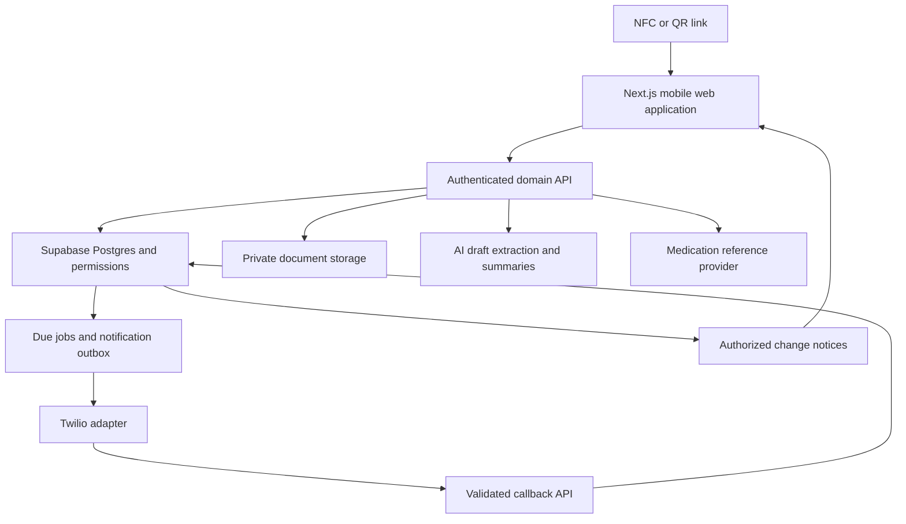

# HandsIn architecture and shared contracts

Planning reference approved for publication November 14, 2026. These are proposed implementation contracts to agree before separately authorized coding, not existing code or database tables. All work remains unassigned.

## System structure

Keep the existing Next.js application and Vercel project. Use Supabase for identity, relational records, private documents, and authorized updates; server-side adapters for AI, medication data and Twilio. Use the proposed Tailwind/shadcn UI stack only after one shared setup change so modules do not install conflicting systems. Preserve the current visual brand.



Business rules live in domain services and database transactions, not in a component’s button handler or an AI prompt. Realtime is for refreshing views; the database is authoritative. A lost websocket must not lose a task completion.

## Shared data conventions

- UUIDs for internal records. Every recipient-specific record includes `circle_id` and `recipient_id`; foreign keys or service invariants prevent mismatched scope.
- UTC event timestamps plus IANA timezone for schedules and human display. A daily recurring task follows the recipient’s configured timezone. Resolve daylight-saving ambiguity explicitly.
- `created_by`, `created_at`, `updated_at`, and integer `version` on mutable records. Server derives actor identity from authentication, not a supplied user ID.
- Preserve original source text, extracted values, reviewer, and review time separately. A family-confirmed transcription is not a clinician-approved medical change.
- Store currency and amounts in integer minor units. No floating-point calculations for shares.
- Distinguish unknown, not applicable, and known-negative values. Missing allergies must not display as “no allergies.”
- Demo fixtures contain synthetic people and health data. Real test SMS numbers belong in restricted configuration, not committed fixtures.

## Record groups

These are conceptual aggregates; implementation may use several tables per row. Build the foundation and first-slice records first, then add migrations for enabled extensions.

| Record group | Minimum contents | Key rule |
| --- | --- | --- |
| Users and circles | Auth identity, display profile, circle, membership | Membership alone does not expose every recipient’s health records |
| Recipients and access | Profile, timezone, optional user link, recipient access grants, consent/authority notes | Same user may help several recipients with different permissions |
| Helper capabilities | Task category, willingness, ability, training status, availability, sharing preference | A self-reported skill is not a credential verification |
| Care plan and instructions | Versioned routines, locations, contacts, preferences, constraints, source, effective dates | Each completed task refers to the instruction version used |
| Medication records | Product/ingredient IDs if resolved, label text, strength, formulation, route, prescriber, pharmacy, review status, active dates | Separate medication identity from the recipient’s prescription |
| Medication schedule versions | Prescription reference, exact instructions, confirmed timing, timezone, effective interval | Editing a schedule does not rewrite historical occurrences |
| Dose occurrences and events | Schedule version, due time, outcome events, actor, source, event time, received time, correction links | One effective outcome per occurrence; preserve corrections as events |
| Visits and appointments | Recipient, start/end, location, type, transport, provider, notes | Calendar entry is not proof that coverage is accepted |
| Task occurrences and assignments | Due window, task category, instructions version, assignee, acceptance, status, linked visit | Keep assignment state separate from completion state |
| Coverage and temporary grants | Original assignment, replacement, tasks, start/expiry, accepted/revoked time, allowed resources | Grant cannot exceed the issuer’s authority or the approved coverage scope |
| Care observations | Recipient, author, time, source, text, linked task/dose/document | Observation is not a new prescription or diagnosis |
| Uploads and AI jobs | Private file reference, document hash, recipient, MIME/size, processing status, model/version, errors | Uploaded text is untrusted data, never model/tool instructions |
| Lab reports and results | Source page, specimen/date/lab/method when present, test, raw result, numeric value or qualitative text, comparator, units, reported range | A value without required context cannot silently join a trend |
| Medication review findings | Checked medication versions, provider/version, timestamp, issue, source, review status, coverage gaps | Missing provider response never produces an all-clear |
| Meal constraints and plans | Allergies/preferences, reviewed medical restrictions, provenance, recipe ingredients, assignments | New substitutions invalidate a previous constraint check |
| Tag registrations | Opaque token, circle/recipient, station or bottle reference, status | Tags do not carry health data, login credentials, or permission grants |
| Notifications and jobs | Target, event, due time, status, attempts, dedupe key, provider ID, acknowledgment | Delivered, read, accepted and completed are different states |
| Service requests and bookings | Duty/shift, recipient, provider reference, requirements, quote, booking status | Distinguish proposed, externally arranged and provider-confirmed |
| Cost agreements and ledger | Service, total/currency, proposed shares/exemptions, agreement version, acceptances, receipt, payment evidence | No financial obligation inferred from task preference or assignment |
| Audit events | Actor, scope, action, target/version, server time, correlation ID | Append history for access, instruction and sensitive workflow changes |

## Domain interfaces

Agree request/response schemas in `src/contracts/` and validate them at runtime. UI modules use domain clients rather than inventing raw table queries. Start with these logical operations; exact URL naming can follow the existing App Router conventions.

| Interface | Input and output | Invariant |
| --- | --- | --- |
| `getRecipientToday` | Recipient/date → due occurrences, tasks, accepted coverage, updates | Only authorized recipient information |
| `createLabelDraft` | Recipient/upload ID → extraction job ID and draft | No active prescription is created by extraction |
| `confirmPrescription` | Draft ID, reviewed fields, expected version → prescription/schedule version | Required fields must be resolved and actor authorized |
| `recordDoseOutcome` | Occurrence ID, outcome, observed time, source, expected version, idempotency key → effective outcome | Server records actor and serializes conflicting updates |
| `requestAssignment` / `respondAssignment` | Task/helper → pending request; request/accept-or-decline → state | Assignment is not accepted until the helper responds |
| `requestCoverage` / `acceptCoverage` | Visit/tasks/time/replacement → request; request ID → scoped grant | Original coverage is not marked replaced before acceptance |
| `getHandoff` | Grant/coverage ID → current task instructions and necessary context | Validate grant and current plan version on every fetch |
| `revokeGrant` | Grant ID → revocation record | Blocks subsequent reads/writes and document access |
| `createLabDraft` / `confirmLabResults` | Upload → extraction draft; reviewed results → committed report | Recipient/date/unit and source association are preserved |
| `reviewMedicationList` | Recipient and list version → issues, coverage status, sources | Results bind to the reviewed list version |
| `suggestMeals` | Reviewed constraint version/preferences → proposed recipes and checks | Output is draft; no medical-rule inference from labs |
| `resolveTag` | Token → authorized context or sign-in/error | Read-only; never marks a task complete on GET |
| `proposeCostAgreement` / `respondCostShare` | Service/shares → proposal; version/response → acceptance | Changes to amounts require a new accepted version |

For writes, use an envelope such as:

```json
{
  "recipientId": "uuid",
  "targetId": "uuid",
  "expectedVersion": 3,
  "idempotencyKey": "unique-client-operation-id",
  "payload": {}
}
```

Return structured errors: `UNAUTHENTICATED`, `FORBIDDEN`, `EXPIRED_GRANT`, `VALIDATION_FAILED`, `VERSION_CONFLICT`, `ALREADY_RECORDED`, `PROVIDER_UNAVAILABLE`. Never translate a timeout into a clinical outcome. For retries, the same idempotency key with a different payload must fail rather than overwrite the first operation.

## Important state machines

**Tasks:** `open → in_progress → completed`; alternatives `declined_by_recipient`, `unable_to_complete`, `canceled`. Overdue is derived from time and unresolved status, not a replacement for the outcome. An “unable” outcome creates visible unresolved work; it must not disappear into a completed count.

**Assignments:** `requested → accepted | declined | expired | canceled`. Reassignment creates a new request with a record of the previous assignment. A family calendar can show plans immediately, but only accepted requests count as confirmed coverage.

**Medication occurrences:** scheduled/pending → `administered_observed`, `taken_self_reported`, `not_given`, `declined`, or `uncertain`. A reminder can flag overdue confirmation without asserting the dose was omitted. A correction supersedes the effective event with an explanation; it does not erase the original. No generic task checkbox may bypass the medication-outcome service.

**Coverage:** `requested → accepted → active → completed | expired | revoked`. Cancellation before acceptance leaves the gap visible. When accepting overlapping coverage, check whether tasks have already been reassigned.

**AI documents:** `uploaded → processing → needs_review → confirmed`; alternatives `failed`, `unsupported`, `superseded`. Retrying should reuse the upload and avoid duplicate records. Confirmed extraction is a transcription state, not medical certification.

**Cost agreements:** `draft → proposed → accepted | disputed | canceled → settled`. Define which selected contributors must accept; partial acceptance does not authorize charging the remainder. External payment claims remain distinguishable from payment-provider confirmation.

## Permission design

App roles describe permitted actions, while task roles describe responsibilities. Keep these separate.

| User context | Allowed baseline | Restricted by default |
| --- | --- | --- |
| Authorized recipient/coordinator | Manage permitted profile, plan, membership and assignments | Other circles and recipients outside their grant |
| Regular helper | View authorized care plan, accept tasks, record outcomes and notes | Altering prescriptions/access/cost agreements without an additional capability |
| Temporary helper | View approved handoff, acknowledge changes, complete granted tasks during coverage | Unrelated records, invitation management, medication edits, finances and bulk export |
| Finance contributor | See their agreed service cost, shares and receipts | Clinical documents unless separately authorized |
| Paid provider | Limited accepted booking/visit information and allowed reporting | Entire family history or unrestricted recipient record |

Use Supabase Row Level Security for database scoping and private storage policies for documents. Supabase documents how RLS enforces access rules inside Postgres. [Supabase RLS](https://supabase.com/docs/guides/database/postgres/row-level-security)

Sensitive instruction fields must be separately projected or stored; row-level rules do not automatically hide columns within a permitted row. Do not give temporary users raw access to a wide recipient profile just to fetch a handoff. Privileged server keys remain server-side, and privileged jobs still validate recipient scope explicitly.

For expiring access, check server time and revocation on every request and mutation. Send realtime invalidation notices without sensitive payloads; refetch through authorization. Clear sensitive client state at expiry, logout, and recipient change. Mediate temporary document access through a checked endpoint; do not issue long-lived public or signed URLs that outlive the grant. Already viewed or saved information cannot be recalled, which is why handoff minimization matters.

Temporary invitations should use short-lived, single-use tokens stored as hashes, bound to the intended verified account or contact. Consuming an invitation creates the explicit grant; a forwarded handoff URL does not. A coordinator can revoke an unaccepted invitation as well as an active grant. Keep invitation and tag tokens separate because tags select context without conferring access.

## Four integration flows

### Label to shared dose record

Upload privately → AI extracts draft → user reviews original alongside fields → medication/schedule saved transactionally → occurrences created → authorized devices refresh → outcome recorded → audit and notification outbox updated in the same transaction. A partial failure must not create a schedule without its reviewed source.

### Coverage to handoff

Request cover → helper accepts → grant and assignment change committed together → handoff assembled from current instruction versions → helper acknowledges → actions recorded through ordinary task/medication services → unresolved items returned to coordinator → expiry/revocation enforced. AI is optional for wording, not required to retrieve instructions.

### NFC to outcome

Read HTTPS tag → sign in if necessary → validate tag and grant → display recipient and bottle/station context → select due occurrence → explicitly confirm outcome → write through `recordDoseOutcome`. A station tag lists candidate doses; it cannot mark all bottles complete. Duplicate taps, browser prefetch, and copied links do not mutate records automatically. QR/manual entry uses the same service.

### Paid service to selective shares

Create uncovered task/service request → record chosen provider and quote → propose contributors and exemptions → obtain required acceptances → record booking status → record service completion → attach invoice → confirm ledger entries. A changed invoice or refund creates an adjustment/revised agreement. Initial implementation supports external arrangement and payment records, not marketplace or payment execution.

## Reliable reminders

Use a server-side recurring job to claim due notification rows; do not rely on a browser tab staying open. Supabase Cron supports recurring jobs and execution history. [Supabase Cron](https://supabase.com/docs/guides/cron)

Recheck the task’s current outcome, assignee, grant and contact preference immediately before dispatch. Use bounded retries and a dead-letter/failed state, with one dedupe key per recipient/event/target/channel. No medical details should be required in an SMS lock-screen preview; link to the authenticated task.

Validate Twilio callback signatures using its SDK and de-duplicate callback IDs. Keep queued/sent/delivered/failed separate from user acknowledgment. Twilio trial accounts restrict calls/messages to verified recipients, so test the exact demo account and phones before depending on it. [Twilio webhook security](https://www.twilio.com/docs/usage/webhooks/webhooks-security), [Twilio trial documentation](https://www.twilio.com/docs/usage/tutorials/how-to-use-your-free-trial-account)

The app is not an emergency monitoring service. Routine reminder escalation goes to configured family contacts; it should not silently imply emergency response or monitored clinical triage.

## External dependencies and fallbacks

| Dependency | Needed for | Failure behavior |
| --- | --- | --- |
| Supabase project, auth configuration and migrations | Shared identity, data and access | Clearly show unavailable service; do not imply a failed write was saved |
| AI API and tested model settings | Label/lab extraction, optional summaries | Preserve upload and allow manual entry/review; display extraction failure |
| Medication terminology/labels | Resolving products and cited instructions | Preserve unresolved original text; no fuzzy match silently becomes authoritative |
| Interaction-data provider | Drug and supported food interaction findings | Explicitly unavailable/partial; no safe verdict |
| Twilio account/sender and tested delivery | Phone reminders | In-app status remains; surface failed SMS; never report simulated delivery as real |
| Compatible NFC tags and phones | Tap entry | QR/manual route remains functional |
| Lab/health-system integration | Connected records | Manual upload remains distinct from connection |
| Aide partner and payment provider | Actual hire/pay flows | External arrangement ledger only, clearly labeled |

Keep provider selection, credentials, rate limits, supported formats, and account readiness in an environment checklist when implementation begins. Do not commit secrets. No vendor access, clinical coverage, price, or free-plan capacity is assumed in this plan.

## Proposed source layout

```text
app/                         routes and shared layout
src/contracts/               validated requests, responses and event types
src/components/              shared visual components
src/features/people/         recipients, roster and role screens
src/features/medications/    labels, schedules and dose UI
src/features/coordination/   tasks, calendar and coverage UI
src/features/health/         lab records, meals and visit briefs
src/features/costs/          services and agreements UI
src/server/domain/          authorization and business rules
src/server/providers/       AI, medication data and Twilio adapters
supabase/migrations/        ordered schema and policy changes
tests/                      critical domain and integrated-flow tests
docs/                       approved product plan and setup
```

This layout is proposed for the existing application, not an instruction to create separate repositories or duplicate projects. API contracts, migration numbering, shared components and dependency changes should be reviewed together before teammates build independently.
