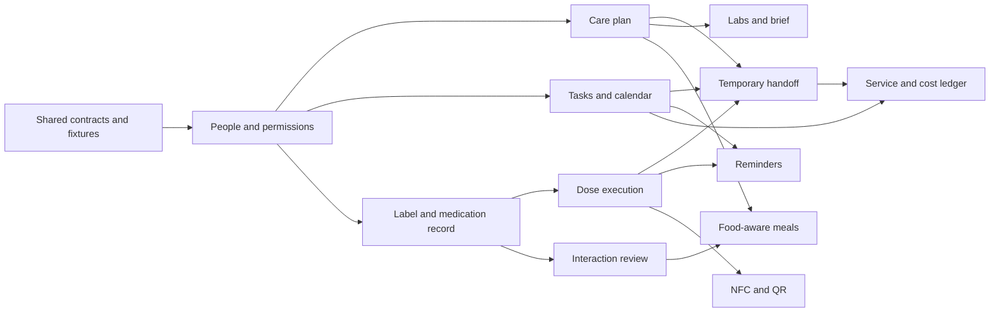

# HandsIn build packages and integration plan

Approved for publication November 14, 2026. The team has four people, but no person or AI is assigned work here. The team selects packages after agreeing on scope and contracts. This document does not authorize implementation or application deployment under the revised definition.

## How to split the build

Use a shared foundation followed by four functional build areas. Each area includes its own screens, domain behavior, and tests against the same contracts. Avoid making one person build every screen while another builds every API: that would create constant handoffs and a late integration bottleneck.

| Unassigned build area | Components it groups | What it exposes to the other areas |
| --- | --- | --- |
| People and access | Profiles, recipient switching, family roster, roles/capabilities, recipient grants, temporary-access enforcement | Authenticated actor, recipient scope, permission checks, profile and handoff projections |
| Medication support | Scan/review, prescription records, schedules, dose occurrences, history, interaction adapter, tag context | Reviewed instructions, due occurrences, dose-outcome service, medication review state |
| Care coordination | Calendar, availability, tasks and acceptance, coverage requests, reminders, service requests and cost agreements | Assigned work, coverage state, notification events, service/cost status |
| Health context and guidance | Care-plan editor, reusable handoff presentation, lab upload/review, meal constraints/ideas, care log, doctor brief | Versioned care instructions, reviewed observations, constrained draft summaries |

These are organization boundaries, not equal-effort promises or assignments. Care coordination has several optional extensions; separate the cost package if that area becomes overloaded. Shared schema, UI primitives, environment setup, and deployment configuration are foundation work that must be resolved before independent implementation. Temporary coverage crosses three areas and is an early integration test.

## Build packages

Size is a relative planning judgment: S = bounded component using existing contracts; M = a complete workflow; L = several workflows or substantial integration uncertainty. It is not a time estimate. Deadline and available service accounts remain unknown.

| Package | Scope and concrete deliverable | Depends on | Size | Acceptance condition |
| --- | --- | --- | --- | --- |
| W00 Shared foundation | Running repo; package-manager setup; shared UI shell; runtime contracts; migrations; synthetic fixtures; provider interfaces; environment example without secrets | Approved first slice | L | Clean install/typecheck/build; two synthetic recipients; fixtures and API schemas usable by all modules |
| W01 People and access | Login, profiles, circles, recipient switcher, roster, recipient permissions and helper capabilities | W00 | L | Two helpers see only their authorized recipients; direct unauthorized API/storage requests fail |
| W02 Care plan and observations | Routines, preferences, locations, contacts, versioned instructions, care log | W00, W01 | M | Another authorized helper can retrieve the same current instructions and see who changed them |
| W03 Calendar and delegation | Visits, recurring task occurrences, availability, assignment requests, acceptance, conflicts and gaps | W00, W01; instructions from W02 | L | A task remains pending until accepted; decline/cancellation exposes a coverage gap; cross-recipient conflicts are visible to the affected user |
| W04 Medication capture | Label upload, extraction draft, side-by-side review, manual entry and prescription versions | W00, W01; upload contract | L | Ambiguous/missing fields remain unresolved; confirmed records preserve source and correct strength/dose distinction |
| W05 Medication execution | Fixed schedules, occurrences, due list, attributed outcomes, corrections and refill tasks | W04; W03 task linking | L | Two devices cannot silently double-confirm one occurrence; schedule edits preserve history and retire stale future reminders |
| W06 Temporary coverage | Request/accept flow, expiring grant, scoped handoff and return notes | W01, W02, W03; W05 for medication tasks | L | Replacement completes a granted task, sees current instructions, cannot access another recipient, and loses access after revocation/expiry |
| W07 Alerts and reminders | In-app reminders, one tested SMS channel, due-job processing, callbacks, acknowledgment and escalation | W03, W05; W01 preferences | L | One due event sends once under retries; canceled/completed work is not notified; failure is visible; a real test phone receives it |
| W08 NFC and QR | Registered station/bottle token, read-only resolver, sign-in continuation, confirmation screen | W01, W05 | M | Actual supported phone opens correct context; tag alone cannot complete a dose; repeated scans do not duplicate an outcome |
| W09 Medication review | Medication identity resolution, duplicate ingredient checks, supported interaction provider, citations and review state | W04; provider access gate | L | Unresolved medicine/provider outage is visible; exact checked list version and sources shown; no all-clear from incomplete data |
| W10 Lab records and brief | Blood/urine upload, reviewed extraction, qualitative/numeric results, comparable trends, questions and brief | W01, W02; upload pipeline from W04 | L | Selected sample reports round-trip correctly; units/ranges/source preserved; incompatible results do not form a misleading trend |
| W11 Meal support | Reviewed constraint editor, preferences, recipe drafts, ingredient checks, shopping/meal tasks | W02, W03; W09 for supported drug-food rules | M to L | Known restrictions persist; missing medical constraints do not become invented rules; substitutions are rechecked |
| W12 Paid help and costs | Uncovered-service request, externally arranged provider/quote, selective share agreement, ledger and receipts | W01, W03, W06 | L | Seven-helper example gives two agreed exemptions and five $30 proposed shares on a $150 service; agreement changes and disputes preserved |
| W13 Connected services | Health-system connections, real provider booking, actual payments, optional AI calls and external calendar sync as separate subprojects | Relevant earlier modules plus vendor/operating readiness | L per subproject | Each integration proves its own authorization, delivery/booking/payment state, failure and cancellation path |
| W14 Integrated verification | End-to-end user flow, access tests, accessibility/mobile checks, failure cases, demo fixtures, documented limitations and rehearsal | All enabled packages | L | Chosen demo runs on the actual phones/accounts with no hidden fixture substitution or broken core steps |

All packages are proposed and unstarted. Screens built against synthetic adapters are useful during development, but they are not evidence of a working external integration. Feature flags must make incomplete modules unmistakable or keep them out of the live demo.

## Components of later connected services

W13 is a group of independent integrations, not one task to finish in an afternoon. Preserve these components in the backlog even if none is enabled in the hackathon.

| Subproject | Necessary components | Readiness gate |
| --- | --- | --- |
| W13a Health-system records | Supported provider connection, explicit consent, secure tokens, identity/recipient matching, record mapping, deduplication, refresh history, disconnect and deletion behavior | Named integration partner and an authorized test connection; a PDF upload is not sufficient |
| W13b Actual aide hiring | Provider/agency onboarding, service area, task qualifications, documented verification status, availability, quote, booking acceptance, cancellation/no-show handling, incident/support process | Provider operating relationship and supported duties are established; booking confirmation comes from the provider |
| W13c Payments | Chosen processor, contributor authorization, accepted agreement version, collection, payout recipient, receipts, reconciliation, refund/failed payment/dispute handling | Defined payment and service model reviewed for the intended US operation; successful test-mode lifecycle, followed by separately authorized live use |
| W13d External calendars | User-authorized connection, minimal scopes, event mapping, timezone rules, privacy-safe titles, update/delete behavior and duplicate prevention | Start with one-way export or one named provider; do not promise generic two-way sync |
| W13e Phone check-in | Consented recipient contact, tested voice flow, speech/DTMF fallback, bounded prompts, authenticated callbacks, attributed self-report, uncertain-response handling and family follow-up | Real call on test phones; no transcription alone becomes observed administration |

## Feature coverage map

| Product features | Build packages |
| --- | --- |
| F01–F02 People, profiles and roles | W00–W01 |
| F03–F04 Prescription capture and execution | W04–W05; W07 for refill/reminder events |
| F05 Medication review | W09 |
| F06–F07 Labs and connected records | W10, W13a |
| F08 Calendar and delegation | W03, W13d |
| F09 Phone alerts | W07; W13e for voice check-ins |
| F10 Temporary access and handoff | W01, W02, W03, W06 |
| F11 Daily care | W02–W03 |
| F12 Meal planning | W11; W09 for supported drug-food findings |
| F13 NFC | W08 |
| F14 Paid help | W12, W13b |
| F15 Cost sharing | W12, W13c |
| F16 Notes and doctor brief | W02, W10 |
| F17 AI calls | W13e |

W14 verifies the combined behavior of whichever packages are enabled.

## Shared contract meeting before splitting work

Resolve these artifacts together, without assigning people in this document:

1. Approve first-release feature IDs from the product catalog and an explicit list of deferred modules.
2. Adopt names for recipient, circle, task occurrence, assignment, instruction version, dose occurrence, and outcome event.
3. Agree the permission matrix, including temporary-helper access, financial access, and who may confirm a prescription transcription.
4. Define request/response schemas and error codes in the shared contract directory.
5. Agree two fictional recipients, several regular helpers, one substitute, one unrelated user, and deterministic schedules.
6. Agree shared UI components and one visual system; avoid independent global CSS resets.
7. Check credentials/accounts privately, exact demo phones, SMS delivery, and interaction-data access.
8. Choose a migration coordination process and a review process for shared contracts; do not have separate branches invent incompatible schemas.

The team can then choose packages based on skill and remaining time. Each package should have an explicitly chosen builder and reviewer in the team’s own board, but those assignments are outside this planning request.

## Integration sequence



**Milestone 0 — Contracts work.** The app runs locally; everyone can consume the same fixtures and domain interfaces. Refresh the repository and verify the exact baseline. Fix the missing package-manager path before calling the environment ready.

**Milestone 1 — One shared action works.** Sign in as two people. Create one recipient-scoped task, accept it, complete it, and see the result in the other session. Demonstrate an unauthorized request being rejected. This proves the application’s foundation before more screens appear.

**Milestone 2 — The care loop works.** Add a reviewed medication record and dose occurrence, connect it to a visit, request a substitute, show the correct handoff, and record the outcome from the substitute’s session. Revoke access and verify it. This is the minimum coherent product story.

**Milestone 3 — Capture and phone entry work.** Connect real label extraction and one tested SMS path. Add NFC/QR if the hardware is available. If extraction fails, use the visible manual flow; if SMS fails, report that failure rather than silently substituting a simulated notification.

**Milestone 4 — Approved extensions work.** Add lab review, the visit brief, constrained meal ideas, medication review where provider access exists, and the cost agreement ledger in small integrated increments. They need not all reach this milestone for the core to remain usable.

**Milestone 5 — Freeze and rehearse.** Stop adding features, run the whole chosen story on actual devices, and fix only regressions and blocking usability issues. Repeat the demo successfully at least three times, as the original brief requested.

Integrate at every milestone. Waiting until the end to combine four independently built apps would leave authentication, data shape, styling, and event semantics unresolved when time is shortest.

## Scope reduction if time runs short

Preserve multiple recipients, clear assignments, reliable completion, and the temporary handoff. Keep manual medication entry if scanning is not ready. Prefer an agenda/day view over a sophisticated calendar grid. Prefer structured handoff templates over AI rewriting. Prefer a service-and-share ledger over real hiring or payment execution.

Do not cut recipient isolation, confirmation before medication logging, instruction provenance, expiry checks, or honest provider-failure states. Those are part of correctness, not optional polish. Provider-dependent interaction and food rules remain unavailable until the integration and supported coverage are established.

## Checks required before a package is merged

- Its interface matches the agreed runtime contract; loading, empty, error and retry states are handled.
- It reads and writes the shared store rather than a private competing copy of application data.
- Its migration and rollback/recovery notes are reviewed; it does not reset teammates’ shared database.
- Relevant typecheck/build and meaningful domain tests pass; critical behavior is demonstrated in the connected app.
- Sensitive operations check identity and recipient scope on the server, including direct API access.
- AI/provider output cannot directly mutate prescriptions or mark care complete.
- Any demo adapter is clearly labeled and cannot be mistaken for a real completed integration.
- Its handoff records changed contracts, setup needs, verified behavior, and remaining limitations.

Use short-lived feature branches in the same repository. Coordinate edits to package files, shared contracts, global styles, schema migrations, and layout. Have the team choose its review/merge process. Preserve commits and build history. Production deployment remains on the existing project; the user has approved publication of this planning packet only.

## Critical integrated tests

| Test | Expected outcome |
| --- | --- |
| Two recipients with similar medicine names | Every action clearly identifies and affects only the selected person |
| Two helpers act on one dose simultaneously | One effective outcome; conflict shown; neither action silently duplicates administration |
| Prescription updated while a task is open | Stale version rejected or refreshed; previous instructions remain in history |
| Blurry or contradictory label | Unresolved draft, no invented dose or silent activation |
| As-needed medicine | No fabricated fixed schedule or catch-up recommendation |
| Helper declines or cannot complete | Task remains visibly unresolved with a path to replacement |
| Substitute link forwarded to another account | Recipient scope is not granted merely by possessing a care URL |
| Grant expires while page is open | Subsequent reads/writes fail; sensitive UI state clears; document route denies access |
| NFC repeated or URL prefetched | No mutation until explicit authenticated confirmation; no duplicate event |
| Phone/device clock wrong | Server time retained separately; user-reported event time cannot silently reorder history |
| SMS callback repeated or forged | Duplicate safely ignored; invalid signature rejected |
| Reminder fires after completion/reassignment | Current state suppresses or redirects it appropriately |
| Daylight-saving or family member in another timezone | Due instant and recipient-local time remain coherent |
| Lab uses different units/method or qualitative results | No misleading numerical conversion or combined trend |
| Uploaded document contains instructions to the AI | Treat as document text; no permission or tool escalation |
| Interaction provider unavailable or medicine unresolved | Explicit gap; never “no interactions” as a fallback |
| Recipe conflicts with a recorded restriction | Rejected or flagged for review, not approved by fluent AI wording |
| Cost share changed after acceptance | New agreement version; no automatic charge or retroactive assent |
| $100 split three ways | Shares sum exactly to $100; remainder policy visible and deterministic |
| Network drops during confirmation | UI distinguishes pending/failed from saved; retry is idempotent |

## Suggested demo stories

**Primary story — A family can hand off care.** Show two recipients in one circle. A family helper reviews a scanned label for one recipient, accepts a scheduled visit, then requests a substitute. The substitute opens a limited handoff, finds the relevant supply location and current instructions, and records a task/dose outcome. The regular family sees who did what and when. Demonstrate that the substitute cannot open the other recipient’s record. A real SMS or NFC step is included only if tested.

**Second story — Relief without penalizing the hands-on caregivers.** Show a personal-care shift requiring outside help, an externally arranged aide record, a $150 service, two agreed exempt helpers, and five proposed $30 shares. Show acceptance and an external-payment ledger, explicitly distinguishing these from live booking and charging.

**Optional health story.** Upload a supported synthetic lab report, review extracted fields, add a question to the visit brief, and show meal ideas based on existing reviewed constraints. Do not imply the lab created a treatment plan.

The two-minute main demo should prove one complete flow. The other stories can be available for questions or a longer walkthrough. This is a recommendation for presentation focus, not a removal of features.

## Handoff template for any teammate or their AI

```text
Read PROJECT_CONTEXT.md and the approved planning packet first.
Package to implement: [team fills in Wxx].
Approved scope and excluded extensions: [team fills in].
Current baseline commit and branch: [team fills in].
Shared contracts and dependencies: [links / versions].
Files or module boundary: [team fills in].
Acceptance criteria: [copy relevant criteria from this plan].
Use the existing repository, deployment target, brand and shared data model.
Do not redesign another module, invent clinical instructions, commit credentials,
or claim a simulated provider call is live.
Propose contract/schema changes before making dependent implementation changes.
Return implemented behavior, verification evidence, setup needs and unresolved gaps.
```

This template is for the team to fill in after choosing work. It does not authorize autonomous delegation or implementation during the current planning phase.

## Publication status and next steps

The user approved publication of this packet on November 14, 2026, with explicit instructions to keep work unassigned and not start building. United States first is confirmed. This packet supplies the shared reference for later, separately authorized work.

The packet is stored under `docs/planning/`, linked from README and `PROJECT_CONTEXT.md`. Future planning revisions should preserve source citations and distinguish approved requirements from proposed implementation choices. Do not overwrite implementation work, rewrite history, assign packages, or begin development without a separate instruction.
