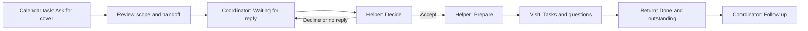

# Mobile screen walkthrough

Low-fidelity wireframes, not implemented screens. All names, places, tasks and times below are fictional. Square brackets indicate controls; boxes indicate screen regions, not a final component library.

Use the established dark teal `#14302E`, cream `#FAF7F2`, sand `#EFE8DD`, coral `#B5462A`; Fraunces headings and DM Sans body. Reuse the existing wordmark treatment; no new logo asset. Coral marks an action or issue, with explicit text rather than color-only meaning. Production should use the team's shared UI setup; do not install a competing style system for this feature.



## 1. Requester — review the handoff

```text
HandsIn                         Close
Cover a visit for Nora
Sun Nov 15 · 2–3 pm Pacific

What needs covering?
[x] Bring the grocery bag inside
[x] Sit together for a short visit
2 tasks · about 45 minutes

If no one accepts, can you attend?
( ) Yes       (x) No
These tasks will show as uncovered.

Who will coordinate if plans change?
Maya · backup: Jordan          [Change]

Replacement
Casey — known friend          [Change]
[I haven't found someone yet]

Handoff                        [Preview]
✓ Location and arrival reviewed
✓ Nora's preferences reviewed
! Confirm where the grocery bag will be
  [Open source instructions]

Recipient sharing approval
Nora's recorded preference reviewed today
[Review who can see what]

[Save draft]  [Invite Casey — disabled]
Resolve the missing supply detail first.
```

After required fields are ready, primary action becomes “Invite Casey.” This wireframe's approval line must come from a real reviewed record, not a prechecked assertion. A non-coordinator sees “Request coordinator review” instead. Editing maintained instructions opens their owning module; a transient visit note is labeled “For this visit only.” No repetitive entry of known address or task list.

## 2. Coordinator — coverage is still open

```text
Nora · Sunday visit
UNCONFIRMED · Casey has not replied
Reply requested by 11 am Pacific
You are coordinating this request.

Original helper cannot attend.
2 tasks still need coverage.

[View invitation] [Choose another helper]
[Cancel request]
```

When the original helper remains available, say “Maya remains confirmed until someone accepts.” Do not call an invitation “secured.” Choosing another helper revokes the previous invite and requires review before issuing another. There is no automatic broadcast or repeated messaging in this slice.

## 3. Intended helper — decide before seeing the home details

```text
HandsIn
Maya asked if you can help Nora
Sun Nov 15 · 2–3 pm Pacific
Demo neighborhood · about 45 minutes

What you'd do
• Bring a grocery bag inside
• Spend some time together
No medication or personal care included.

Before you decide
Please review the task requirements.
Nora prefers people she has met before.
Exact arrival details open after acceptance.

[Ask Maya a question]
[I can cover this visit]
[I can't cover]   [I can cover part]
Please reply by 11 am Pacific.
```

Account verification precedes this view. A forwarded link opens a generic sign-in/unavailable screen. “I can cover part” initiates a scope discussion; it does not secure any tasks. A brief acceptance confirmation repeats recipient, date, tasks and what access will be shared. While saving: “Confirming your acceptance…”; after server acknowledgment: “You're confirmed for Nora's visit.” Do not imply acceptance verifies training.

## 4. Helper — prepare, then do

```text
Nora's Sunday visit             Help
CONFIRMED · Nov 15, 2–3 pm Pacific
Your handoff is available until 3 pm.

Before you go
Demo home A · arrival instructions [View]
Maya is your contact               [Contact]
Backup: Jordan                    [Contact]

About this visit
“Please call me Nora. Ask before putting
things away; I like choosing where they go.”
Reviewed by Nora and Maya · Nov 14

Tasks                       0 of 2 recorded
1 Bring the grocery bag inside       [Open]
2 Sit together for a short visit      [Open]

[I'm here] — available during visit
```

No “I'm here” requirement blocks reporting that a task could not happen. Arrival is optional self-report, independently visible to the team. In-visit task detail:

```text
Nora · Bring the grocery bag inside
Due during 2–3 pm Pacific

Bag: on the bench beside the front door.
Ask Nora where she would like it placed.
Do not add other duties to this visit.
Source: reviewed household note · version 2
Reviewed by Maya · Nov 14         [Details]

Status: No outcome recorded
[Record done]
[Nora declined] [I couldn't do this]
[I'm unsure / need help]
```

Optional observation is short and factual. “Nora declined” is not a failure score. If someone else has already recorded a result, replace actions with the saved result and an appropriate correction/request-review path. For a changed instruction, display “The bag location changed since you accepted. Review the current directions.” Require acknowledgment of the new version before the affected action; preserve the source and changed time.

## 5. Helper return and coordinator follow-up

```text
Finish Nora's visit
Recorded
✓ Grocery bag brought inside · Casey, 2:20 pm

Needs follow-up
• Visit declined by Nora; no further attempt
  requested. Coordinator: Maya

Anything the next helper should know?
[Optional factual note, max 1,000 characters]

[Review and submit report]
Submitting ends this temporary handoff access.
```

```text
Nora · Casey's report received
Reported 2:40 pm Pacific
1 done · 1 declined · 0 without a report

Follow-up for Maya
Nora declined the visit. Review whether any
follow-up is wanted; do not repeat care by default.
[Acknowledge and review] [Arrange follow-up]

Acknowledging doesn't resolve the task.
```

For unresolved work, “Arrange follow-up” uses calendar/task services with a named owner. Refusal may need only respectful acknowledgment, not another task; coordinator explicitly records the disposition. Unsure/no-report outcomes remain visible without asserting nonperformance.

## Essential non-happy states

| State | Copy and next action |
| --- | --- |
| Empty coordinator list | “No coverage requests for this person. Start from a visit or task.” |
| No tasks left | “These tasks already have recorded outcomes. Review the visit before requesting coverage.” |
| Loading handoff | “Loading your current instructions…” Disable care-result actions; no old recipient content flashes |
| Read failure | “We couldn't load the current handoff. Try again or contact Maya.” Never substitute old clinical instructions |
| Unsaved result | “Not confirmed saved. Check the task status before trying again.” Keep safe in-memory draft until access ends; same request ID on retry |
| Expired | “Your access for this visit has ended. Contact the coordinator if you need to report something.” No hidden sensitive background page |
| Revoked / denied / wrong account | “This handoff isn't available to this account.” Offer correct-account sign-in; no person/address leaked |
| Already accepted elsewhere | “This request changed before your acceptance was saved. Review the latest request.” |
| Scope changed | “The time or tasks changed. Review before confirming again.” Show current scope and what changed |
| Permission service unavailable | “We can't verify access right now. Try again.” Fail closed |

## Accessibility and interaction checks for the later prototype

Single column at 320–430 CSS pixels; body text at least 16px; controls comfortably at least 44px tall; semantic headings/buttons/forms; explicit labels and visible focus; text status in addition to icons/color. Avoid dense calendar grids and hover-only instructions. Keep recipient identity adjacent to final confirmation. Announce save/error feedback with an appropriate live region and move focus to actionable validation errors. Keyboard-accessible dialogs restore focus and support Escape; preserve drafts when navigation is accidental while access remains valid. Support 200% zoom, long names, reduced motion, screen-reader order and recipient timezone labels. Display helper-local time as secondary only when it differs. Contrast and real-device usability are planned checks, not claimed results of these text wireframes.
